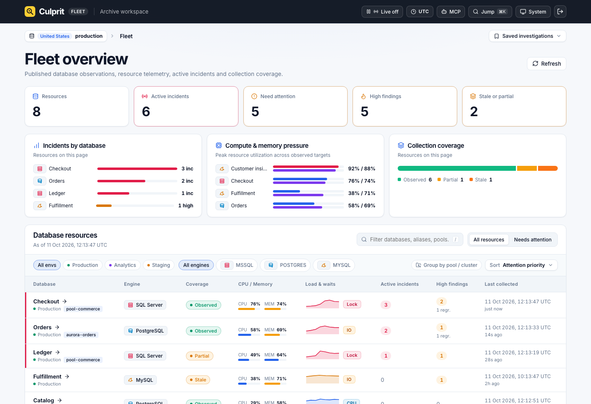
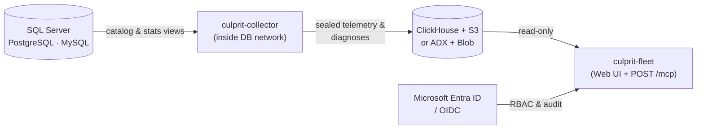

<div align="center">


# Culprit Fleet

**Self-hosted database fleet command center, archive time-machine, and MCP server for SQL Server, PostgreSQL, and MySQL.**

[](https://github.com/culpritsql/culprit-fleet/actions/workflows/check.yml)
[](https://github.com/culpritsql/culprit-fleet/actions/workflows/publish.yml)
[](https://culpritsql.github.io/culprit-fleet/)
[](https://github.com/culpritsql/culprit-sql-studio)
[](LICENSE)

[Architecture](#architecture) · [1. Collector](#1-deploy-the-collector) · [2. Deploy Fleet](#2-deploy-culprit-fleet) · [3. MCP for Agents](#3-connect-coding-agents-mcp) · [Live Demo](https://culpritsql.github.io/culprit-fleet/) · [Self-Hosting Guide](docs/self-hosting.md)

</div>

<picture>
  <source media="(prefers-color-scheme: dark)" srcset="docs/images/fleet-dark.png">
  
</picture>

## Architecture

Culprit separates **database collection** from **fleet investigation** so engineers and coding agents never need network access or credentials to production databases:



- **Zero production blast radius**: `culprit-fleet` reads exclusively from your analytical archive (**ClickHouse + S3** or **Azure Data Explorer + Azure Blob**). You can investigate lock storms, deadlocks, wait spikes, schema bloat, and execution plan flips hours or weeks after the database has recovered or scaled down.
- **Multi-region scale units**: Connect dozens of regional shards in one configuration ([config/web.regional.example.json](config/web.regional.example.json)) with per-archive and per-database RBAC mapped from Microsoft Entra ID / OIDC claims.
- **Built-in MCP server**: Exposes the same read-only fleet, incident, workload, and plan-diff tools at `POST /mcp` under the user's Entra ID identity and audit log.

---

## 1. Deploy the Collector

Run [`culprit-collector`](https://github.com/culpritsql/culprit-sql-studio) inside each database network/VPC to capture lightweight catalog and DMV/pg_stat snapshots, run Culprit's diagnostic engine locally, and publish sealed captures to ClickHouse + S3 or ADX + Azure Blob:

```sh
helm upgrade --install culprit-collector oci://ghcr.io/culpritsql/charts/culprit-collector \
  --namespace culprit --create-namespace \
  -f collector-values.yaml
```

Full collector setup, sink schemas, and database least-privilege grants: **[culprit-sql-studio → docs/collector.md](https://github.com/culpritsql/culprit-sql-studio/blob/main/docs/collector.md)**.

---

## 2. Deploy Culprit Fleet

Point `culprit-fleet` at your published archive(s) and OIDC provider ([config/web.example.json](config/web.example.json)) and deploy with one Helm command:

```sh
helm upgrade --install culprit-fleet oci://ghcr.io/culpritsql/charts/culprit-fleet \
  --namespace culprit --create-namespace \
  --set imageTag=main \
  --set config.existingConfigMap=culprit-fleet-config \
  --set existingSecret=culprit-fleet-credentials \
  --set persistence.existingClaim=culprit-fleet-state
```

Or run the multi-arch container (`linux/amd64`, `linux/arm64`) directly with Docker:

```sh
docker run --rm -p 127.0.0.1:8080:8080 \
  -v "$PWD/runtime/config:/run/config:ro" \
  -v culprit-fleet-state:/var/lib/culprit-fleet \
  -v "$PWD/runtime/secrets:/run/secrets:ro" \
  ghcr.io/culpritsql/culprit-fleet:main
```

Full configuration for Microsoft Entra ID / OIDC role mapping, per-database grants, ClickHouse/ADX credentials, and Ingress TLS: **[docs/self-hosting.md](docs/self-hosting.md)**.

---

## 3. Connect Coding Agents (MCP)

Coding agents (Claude Code, Cursor, VS Code) connect directly to `POST /mcp` using OAuth 2.1 / Microsoft Entra ID Bearer tokens — zero static API keys, identical RBAC grants, and full `access_audit` logging:

```sh
# Auto-discovers /.well-known/oauth-protected-resource, or pass an Azure CLI Entra token:
TOKEN="$(az account get-access-token --resource api://<ENTRA-CLIENT-ID> --query accessToken -o tsv)"
claude mcp add --transport http culprit-fleet "https://fleet.example.com/mcp" \
  --header "Authorization: Bearer ${TOKEN}"
```

Exposed tools: `list_archives`, `fleet_overview`, `investigate_incident`, `query_database_window`, `diff_execution_plans`.

---

## Try the Demo

Open the **[hosted interactive demo](https://culpritsql.github.io/culprit-fleet/)** in your browser (static mode, zero backend required), or run the local demo server with Bun:

```sh
git clone --recurse-submodules https://github.com/culpritsql/culprit-fleet.git
cd culprit-fleet
bun install --frozen-lockfile && bun run demo
```

For local builds, end-to-end Playwright verification, and ClickHouse/S3 integration tests, see **[docs/development.md](docs/development.md)**.

## License

[MIT](LICENSE)
