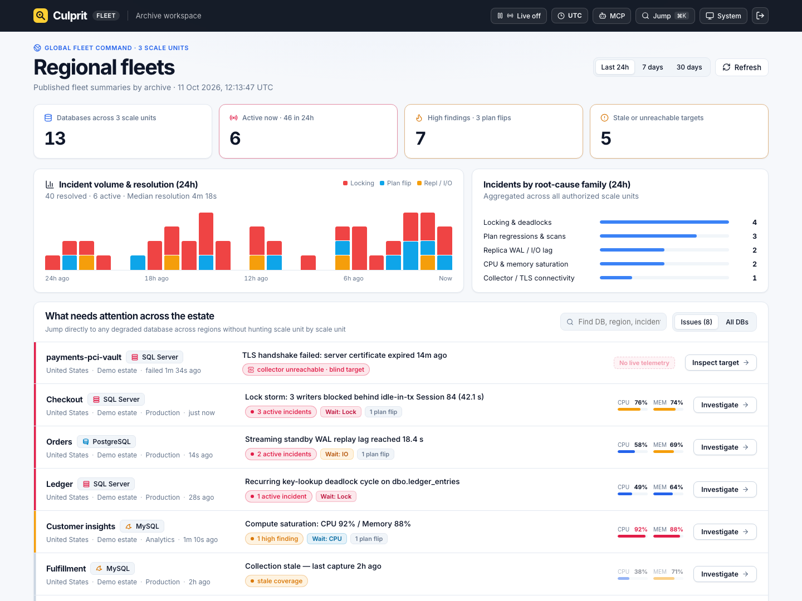
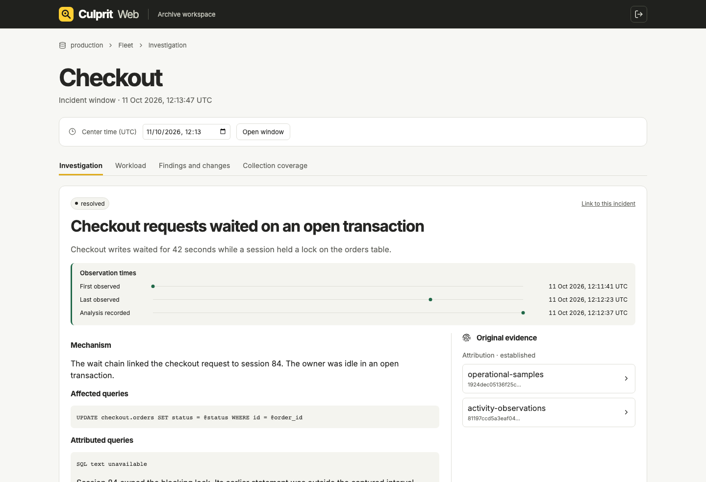
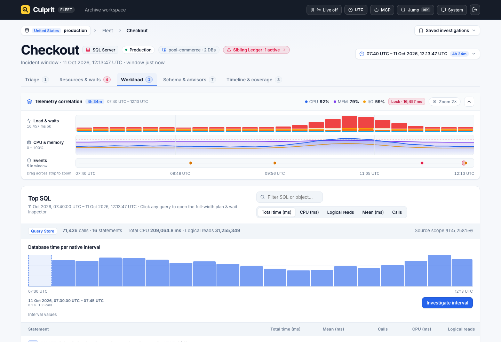

<div align="center">


# Culprit Web

**Database fleet command center and archive time-machine — investigate incidents, resource spikes, plan regressions and deadlocks even after the database has recovered.**

[](https://github.com/culpritsql/culprit-web/actions/workflows/check.yml)
[](https://github.com/culpritsql/culprit-web/actions/workflows/publish.yml)
[](https://culpritsql.github.io/culprit-web/)
[](https://github.com/culpritsql/culprit-sql-studio)
[](docs/self-hosting.md)
[](LICENSE)

[Fleet](#fleet) · [Investigations](#investigations) · [Historical workload](#historical-workload) · [Live demo](#try-the-demo) · [Quickstart](#quickstart)

</div>

## Fleet

See which databases need attention across regions, monitor CPU and memory saturation, group shared compute pools and HA clusters, spot silent collector targets, and jump anywhere instantly with `⌘K`. Switch between five curated themes (**Culprit Obsidian**, **Midnight Nebula**, **Operator Terminal**, **Daylight Paper**, **Nordic Frost**) or follow your OS theme automatically.

<picture>
  <source media="(prefers-color-scheme: dark)" srcset="docs/images/fleet-dark.png">
  
</picture>

## Try the demo

Explore the [hosted interactive demo](https://culpritsql.github.io/culprit-web/) directly in your browser (zero backend required), or run the sample estate locally with Bun:

```sh
git clone --recurse-submodules https://github.com/culpritsql/culprit-web.git
cd culprit-web
bun install --frozen-lockfile
bun run demo
```

Open [Regional fleets](http://127.0.0.1:4390/?view=regions). Choose the United States, open **Checkout**, inspect **Resources & waits** (CPU/memory curves, wait breakdown, session blocking tree and deadlock graph), or open **Workload** and click **Compare plans** on the top statement.

To build the standalone static showcase bundle:

```sh
bun run build:demo
```

<picture>
  <source media="(prefers-color-scheme: dark)" srcset="docs/images/regions-dark.png">
  
</picture>

## Quickstart

Connect a published **ClickHouse + S3** or **Azure Data Explorer + Azure Blob** archive and your company's OIDC provider. One service serves the React app, handles sign-in and reads the configured archives. Give each regional archive its own endpoints, object storage and access grants. The collector and source database can be offline.

```sh
git clone --recurse-submodules https://github.com/culpritsql/culprit-web.git
cd culprit-web
bun install --frozen-lockfile
bun run build
cargo run --locked -- /absolute/path/to/web.json
```

For credentials, role mappings, HTTPS, prebuilt multi-arch `ghcr.io/culpritsql/culprit-web` containers, the `oci://ghcr.io/culpritsql/charts/culprit-web` Helm chart, and connecting coding agents via `POST /mcp` (Microsoft Entra ID / OIDC), follow the [self-hosting guide](docs/self-hosting.md). Start with the [example web configuration](config/web.example.json).

## Investigations

Save a view for your next shift or share a link to the database, time window and incident revision. Correlate load spikes, CPU/memory pressure and incidents on the synchronized multi-lane timeline, follow a waiting statement to its recorded head blocker, inspect captured deadlock cycles (`@culpritsql/plan-viewer`), and open authenticated original evidence.

<picture>
  <source media="(prefers-color-scheme: dark)" srcset="docs/images/investigation-dark.png">
  
</picture>

## Historical workload

Rank statements by total time, CPU time, logical reads, mean duration or calls, with resource-share percentages per query. Drag across a spike or select buckets with the keyboard to investigate that exact interval. Click any statement to open the wide slide-over inspector drawer with syntax-highlighted SQL, recorded waits, runtime by plan, interactive execution plan diagrams and side-by-side structural plan comparisons (`PlanViewer` and `PlanDiffViewer`).

<picture>
  <source media="(prefers-color-scheme: dark)" srcset="docs/images/workload-dark.png">
  
</picture>

The screenshots use a sample estate and Culprit's SQL Server workload fixture. The native integration test separately verifies a published PostgreSQL blocker and its original SQL on ClickHouse and S3-compatible storage. The browser suite reproduces the same journey across themes. [Development and verification](docs/development.md)
